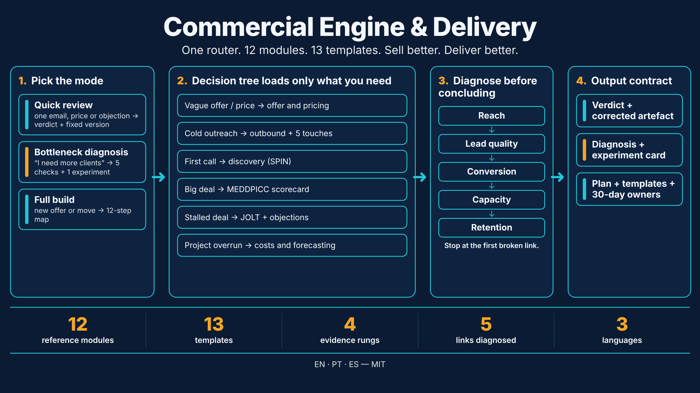
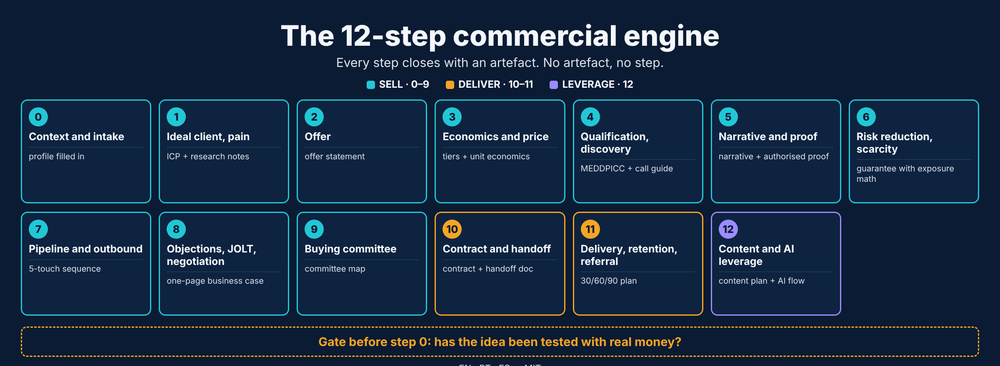
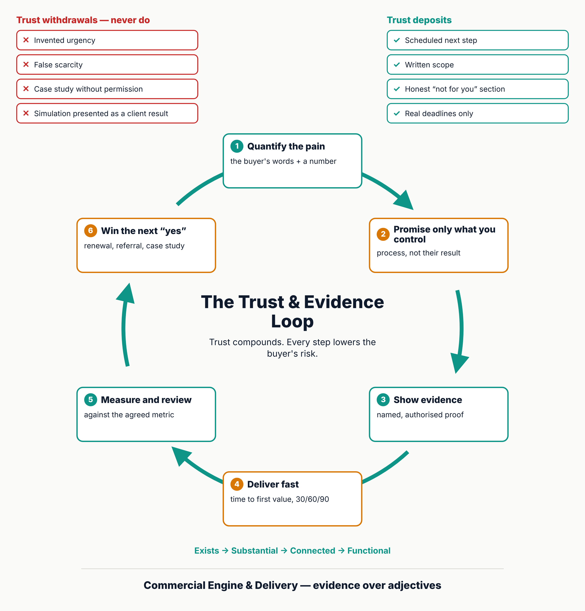

# Commercial Engine & Delivery — Claude Skill

**English** · [Português](https://github.com/C48H74/motor-comercial-e-gestao-pt) · [Español](https://github.com/C48H74/motor-comercial-y-gestion-es)



A Claude skill for B2B businesses with complex sales cycles. It covers two connected fronts: **selling** (offer, pricing, outbound, discovery, qualification, negotiation) and **delivering** (scope, schedule, cost, risk, status). The commercial front promises; the delivery front fulfils. Using one without the other breaks the business.

| Language | Repository | Skill name |
|---|---|---|
| English (main) | [`commercial-engine-and-delivery`](https://github.com/C48H74/commercial-engine-and-delivery) | `commercial-engine-and-delivery` |
| Português | [`motor-comercial-e-gestao-pt`](https://github.com/C48H74/motor-comercial-e-gestao-pt) | `motor-comercial-e-gestao-pt` |
| Español | [`motor-comercial-y-gestion-es`](https://github.com/C48H74/motor-comercial-y-gestion-es) | `motor-comercial-y-gestion-es` |

The three versions have the same structure and content. English is the source; Portuguese and Spanish are translations.

## What it covers

| Part | Content |
|---|---|
| `SKILL.md` | Router: rules that outrank all others, 3 modes (quick review, bottleneck diagnosis, full build), situation-to-module table, output contract |
| `references/` (12) | Evidence and profile, offer and pricing, sales methodologies (SPIN, MEDDPICC, JOLT, Challenger), outbound and objections, 12-step engine, project delivery (PMBOK 7), costs and forecasting (EVM, PERT), risk, people and rituals, standards and benchmarks (ISO 21502, ISO 31000, PMI Pulse), engine architecture, validation and negotiation |
| `templates/` (13) | Business profile, idea-validation script, consultative-sales script, integrative-negotiation script, proposal and guarantee, experiment card, 30/60/90 plan, project charter, status report, RACI, risk register, kickoff script, anti-patterns checklist |
| `scripts/` (2) | Structure validator and YAML frontmatter validator (Node.js) |



Every claim needs a source, every missing fact becomes `[to fill in]`, and every deliverable states how far up the evidence ladder it got.



## Installation

**Claude app/web:** download this repository as a ZIP and upload it in the skills area of your account.

**Claude Code:**

```bash
git clone https://github.com/C48H74/commercial-engine-and-delivery.git ~/.claude/skills/commercial-engine-and-delivery
```

## Usage

> Use the commercial-engine-and-delivery skill to review the offer and pricing of my [describe the business].

The skill asks first for what is missing (the minimum of the business profile), then returns a verdict, the corrected artefact or a diagnosis with one experiment card, and ends with **advance / correct / discard**.

Check the package after editing it:

```bash
node scripts/validate_skill.mjs .
npm install yaml && node scripts/validate_yaml.mjs .
```

## Sources and limits

A synthesis of public methods and standards: PMBOK Guide 7th edition (PMI), SPIN Selling (Rackham), MEDDPICC, *The Challenger Sale* (Dixon, Adamson), *The JOLT Effect* (Dixon), ISO 21502:2020, ISO 31000:2018, PMI Pulse of the Profession, and practitioner talks by Rony Meisler and Alfredo Soares.

Not everything was checked against the primary source. Items marked **not verified** or "according to the author" must not be quoted as fact; the *Known limits* section of `SKILL.md` lists what is still open. ISO clauses were synthesised from third-party presentations, and reference 12 comes from an unverified video compilation.

Educational content. Not a substitute for legal, accounting or tax advice.

## License

[MIT](LICENSE)

## Author

Daniel de Souza Paixão — [LinkedIn](https://www.linkedin.com/in/daniel-paixao-b5988230)
